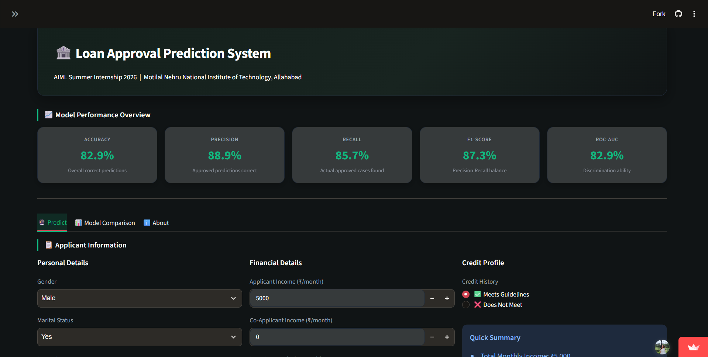
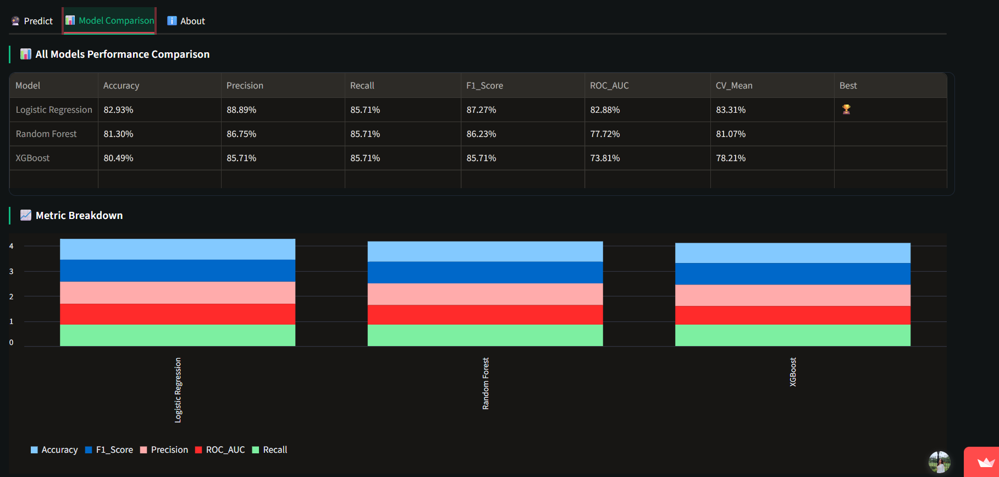
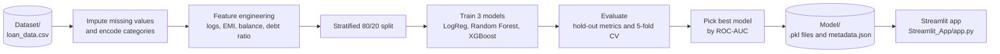

<p align="center">
  
</p>

<p align="center">
  
</p>

<p align="center">
  <a href="https://sonalpriyanshi529-loanapprovalpredictio-streamlit-appapp-7g07t0.streamlit.app/"></a>
</p>

<p align="center">
  
  
  
  
  
</p>

<p align="center">
  <b>AIML Summer Internship 2026 &mdash; Motilal Nehru National Institute of Technology, Allahabad</b>
</p>

<p align="center">
  <a href="#overview">Overview</a> &bull;
  <a href="#results">Results</a> &bull;
  <a href="#the-web-app">Web App</a> &bull;
  <a href="#ml-pipeline">Pipeline</a> &bull;
  <a href="#dataset">Dataset</a> &bull;
  <a href="#getting-started">Getting Started</a> &bull;
  <a href="#project-structure">Structure</a> &bull;
  <a href="#troubleshooting">Troubleshooting</a>
</p>

---

## Overview

Banks review a very large number of loan applications, and manual review is slow and inconsistent. This project builds a supervised **binary classifier** that predicts whether a loan application will be **Approved (Y)** or **Rejected (N)**, and serves it through an interactive web app.

It covers the full machine-learning lifecycle:

1. Data loading and missing-value handling
2. Encoding and feature engineering
3. Training and comparing three models
4. Evaluation with hold-out metrics and 5-fold cross-validation
5. Saving the artifacts and serving predictions in a **Streamlit** app

> ### 🚀 [**Try the live demo**](https://sonalpriyanshi529-loanapprovalpredictio-streamlit-appapp-7g07t0.streamlit.app/)

---

## Results

Three models were trained on an 80/20 stratified split (491 training rows, 123 test rows, random seed 42). The best model is chosen automatically by **ROC-AUC**, and **Logistic Regression** came out on top.

| Model | Accuracy | Precision | Recall | F1-Score | ROC-AUC | 5-Fold CV Accuracy |
|---|:---:|:---:|:---:|:---:|:---:|:---:|
| **Logistic Regression** 🏆 | **82.93%** | **88.89%** | 85.71% | **87.27%** | **82.88%** | 83.31% ± 5.21% |
| Random Forest | 81.30% | 86.75% | 85.71% | 86.23% | 77.72% | 81.07% ± 3.85% |
| XGBoost | 80.49% | 85.71% | 85.71% | 85.71% | 73.81% | 78.21% ± 3.29% |

<sub>Source: <code>Model/metadata.json</code>, written by <code>train_model.py</code>. Metrics are for the approved class on the 123-row hold-out set.</sub>

> [!NOTE]
> The test set is small and the cross-validation spread is about ±3–5 points, so the gaps between models are modest. Treat the ranking as indicative rather than definitive, and re-run `train_model.py` to reproduce the numbers on your own machine.

---

## The Web App

The Streamlit app (`Streamlit_App/app.py`) has a dark dashboard theme with an emerald accent and three tabs:

| Tab | What it does |
|---|---|
| **🔮 Predict** | Enter an applicant's details and get an **Approved / Rejected** result with the approval and rejection probabilities, plus a short summary of key factors (credit history, total income, loan amount, education, EMI burden). |
| **📊 Model Comparison** | A table and bar chart comparing all three models on every metric, with the active model marked. |
| **ℹ️ About** | Project background, pipeline steps, folder layout and a note on fixing model-version errors. |

A sidebar shows the **active model** and its performance metrics.

**Inputs on the Predict tab**

| Applicant | Finances | Loan and property |
|---|---|---|
| Gender | Applicant income (₹ / month) | Loan amount (₹ thousands) |
| Marital status | Co-applicant income (₹ / month) | Loan term (months) |
| Dependents (0, 1, 2, 3+) | Credit history (good / poor) | Property area (Urban, Semiurban, Rural) |
| Education | | |
| Self-employed | | |

### Screenshots

<p align="center">
  
</p>
<p align="center"><sub><b>Predict tab:</b> performance overview of the active model, and the applicant information form.</sub></p>

<p align="center">
  
</p>
<p align="center"><sub><b>Model Comparison tab:</b> all three models side by side on every metric.</sub></p>

---

## ML Pipeline



### Preprocessing

- `Loan_ID` is dropped.
- Missing **Gender, Married, Dependents, Self_Employed, Credit_History and Loan_Amount_Term** are filled with the most frequent value; missing **LoanAmount** with the median.
- `Dependents` is converted to a number (`3+` becomes `3`).
- **Gender, Married, Education, Self_Employed and Property_Area** are label-encoded.
- The target `Loan_Status` becomes `1` (Y) or `0` (N).
- A `StandardScaler` is applied for Logistic Regression only; the tree-based models use unscaled features.

### Feature engineering

Seven features are derived, and the raw income and loan-amount columns are then dropped. The final model uses **15 features**.

| Feature | Formula |
|---|---|
| `Log_ApplicantIncome` | `log1p(ApplicantIncome)` |
| `Log_CoapplicantIncome` | `log1p(CoapplicantIncome)` |
| `Log_LoanAmount` | `log1p(LoanAmount)` |
| `Log_TotalIncome` | `log1p(ApplicantIncome + CoapplicantIncome)` |
| `EMI` | `LoanAmount / Loan_Amount_Term` |
| `Balance_Income` | `TotalIncome − (EMI × 1000)` |
| `Debt_Income_Ratio` | `LoanAmount / TotalIncome` |

### Models

| Model | Configuration |
|---|---|
| **Logistic Regression** | `C=1.0`, `max_iter=1000`, `solver="lbfgs"`, on standardised features |
| **Random Forest** | 200 trees, `max_depth=10`, `min_samples_split=5` |
| **XGBoost** | 200 estimators, `max_depth=6`, `learning_rate=0.1`, `subsample=0.8`, `colsample_bytree=0.8` |

**Evaluation:** Accuracy, Precision, Recall, F1-Score, ROC-AUC, and 5-fold stratified cross-validation accuracy (mean ± standard deviation).

---

## Dataset

| | |
|---|---|
| **File** | `Dataset/loan_data.csv` |
| **Size** | 614 applications, 13 columns (12 inputs plus `Loan_Status`) |
| **Target balance** | 417 Approved (≈68%) and 197 Rejected (≈32%) |
| **Missing values** | Gender 14, Married 11, Dependents 10, Self_Employed 20, LoanAmount 25, Loan_Amount_Term 15, Credit_History 53 |

The columns follow the schema of the Kaggle [Loan Prediction Problem Dataset](https://www.kaggle.com/datasets/altruistdelhite04/loan-prediction-problem-dataset). The copy of `loan_data.csv` committed to this repository is the **synthetic demonstration dataset** that `train_model.py` generates (fixed seed 42), so the results above describe this synthetic data, not real lending records.

To train on the real Kaggle data instead, download `train.csv`, rename it to `loan_data.csv`, replace the file in `Dataset/`, and run `python train_model.py` again.

---

## Getting Started

### 1. Clone the repository

```bash
git clone https://github.com/sonalpriyanshi529/LoanApprovalPrediction.git
cd LoanApprovalPrediction
```

### 2. Create a virtual environment (recommended)

```bash
python -m venv venv
source venv/bin/activate        # Linux / macOS
venv\Scripts\activate           # Windows
```

### 3. Install dependencies

```bash
pip install -r requirements.txt
```

### 4. Train the models

```bash
python train_model.py
```

This reads `Dataset/loan_data.csv`, trains all three models, and writes the artifacts and `training.log` into `Model/`. If the dataset file is missing, the script tries to download one and, failing that, generates the synthetic dataset. Training with your own Python and scikit-learn versions avoids pickle-compatibility errors.

### 5. Launch the app

```bash
streamlit run Streamlit_App/app.py
```

Open **http://localhost:8501** in your browser. Run the command from the project root so the app can find the `Model/` folder.

---

## Notebook

`Notebook/Loan_Approval_Prediction.ipynb` walks through the same workflow step by step, written for **Google Colab**: dependencies, data loading, EDA, preprocessing, model building, evaluation, saving the artifacts and an inference test. When you run it, it saves the EDA and evaluation charts (category and numeric distributions, correlation heatmap, model comparison, confusion matrices, ROC curves and feature importance) as PNG files, and offers a `Model_artifacts.zip` download. If those artifacts show a version mismatch locally, run `python train_model.py` instead.

---

## Project Structure

```text
LoanApprovalPrediction/
├── Dataset/
│   └── loan_data.csv              Dataset (614 rows, 13 columns)
├── Notebook/
│   └── Loan_Approval_Prediction.ipynb   Step-by-step Colab notebook
├── Model/
│   ├── best_model.pkl             Best model (Logistic Regression)
│   ├── logistic_regression.pkl    Individual trained models
│   ├── random_forest.pkl
│   ├── xgboost.pkl
│   ├── scaler.pkl                 Fitted StandardScaler
│   ├── label_encoders.pkl         Fitted LabelEncoders
│   ├── feature_names.pkl          Ordered feature list
│   ├── model_metrics.pkl          All evaluation results
│   ├── metadata.json              Human-readable summary of the run
│   └── training.log               Log of the last training run
├── Streamlit_App/
│   └── app.py                     Streamlit web application
├── Documentation/
│   ├── Project_Report.md          Technical project report
│   └── screenshots/               App screenshots used in this README
│       ├── app-predict.png
│       └── app-model-comparison.png
├── train_model.py                 Retrain locally and regenerate Model/
├── requirements.txt               Python dependencies
└── README.md                      This file
```

---

## Tech Stack

| Area | Tools |
|---|---|
| **Language** | Python (the included models were trained with 3.12.3) |
| **Machine learning** | scikit-learn, XGBoost |
| **Data** | pandas, NumPy |
| **Model storage** | joblib (`.pkl` files) |
| **Visualisation (notebook)** | Matplotlib, Seaborn |
| **Web app** | Streamlit |
| **Dataset download (optional)** | Kaggle API |

Minimum versions are listed in [`requirements.txt`](requirements.txt).

---

## Troubleshooting

<details>
<summary><b><code>ValueError: Protocol 5 is not supported</code> or a scikit-learn version error</b></summary>

The `.pkl` files were created with a different Python or scikit-learn version. Regenerate them locally:

```bash
python train_model.py
```

</details>

<details>
<summary><b><code>ModuleNotFoundError: No module named 'xgboost'</code></b></summary>

```bash
pip install xgboost
```

</details>

<details>
<summary><b>The Streamlit app cannot find the model files</b></summary>

Launch it from the project root:

```bash
cd LoanApprovalPrediction
streamlit run Streamlit_App/app.py
```

</details>

---

## Limitations

- This is a learning project. It is **not** a real credit-decision system and should not be used to approve or reject actual loans.
- The bundled dataset is synthetic (see [Dataset](#dataset)), and the test set is small, so reported scores should be read as indicative.
- Only simple models and default-style hyperparameters were used; there is no hyperparameter search.

---

## Documentation

- [`Documentation/Project_Report.md`](Documentation/Project_Report.md): technical project report
- [`Notebook/Loan_Approval_Prediction.ipynb`](Notebook/Loan_Approval_Prediction.ipynb): step-by-step notebook
- [`Model/training.log`](Model/training.log) and [`Model/metadata.json`](Model/metadata.json): output of the last training run

---

## Author

**AIML Summer Intern 2026**
Motilal Nehru National Institute of Technology, Allahabad

<p align="center">
  <sub>Built as part of the AIML Summer Internship 2026 &nbsp;&bull;&nbsp; <a href="https://sonalpriyanshi529-loanapprovalpredictio-streamlit-appapp-7g07t0.streamlit.app/">Open the live demo</a></sub>
</p>
